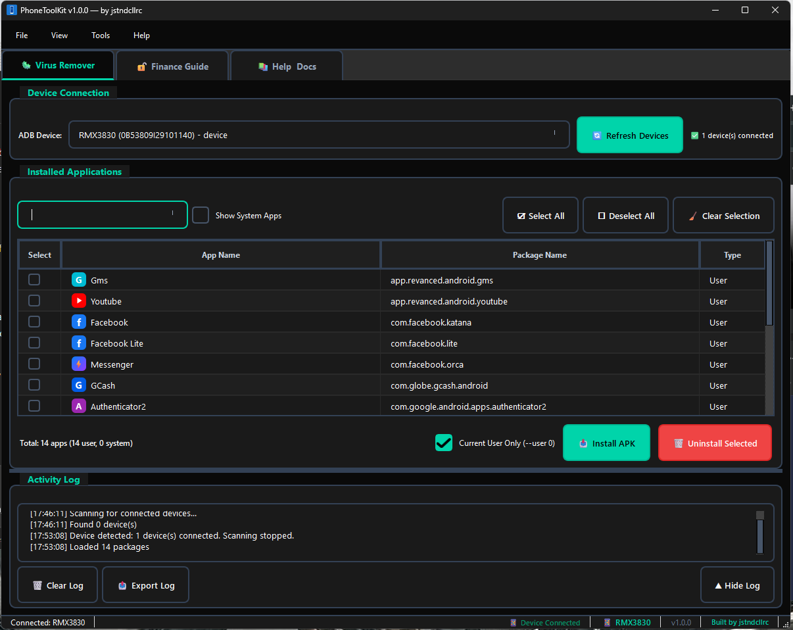

# PhoneToolKit


> **All-in-One Android Device Management Tool** — Combines a **Virus Remover** (ADB-based app uninstaller with dynamic icons) and a **Finance Lock Removal Guide** (covering 5 major phone brands with 18 unlock methods).

---

## 📸 Screenshots

| Light Mode | Dark Mode |
|:---:|:---:|
|  |  |

*Add screenshots to `docs/screenshots/` folder*

---

## ✨ Features

### 🦠 Virus Remover (ADB App Uninstaller)
- **Auto-detect devices** — Background scanning stops instantly when device connects, resumes when unplugged
- **Dynamic app icons** — 30+ brand-authentic icons (YouTube, Chrome, Facebook, GCash, Payjoy, etc.) + generated fallbacks
- **Native sortable checkboxes** — Check states stay aligned with rows during sorting
- **Batch uninstall** with progress tracking and detailed logging
- **Current User Only (`--user 0`)** mode — No root required, reversible, safer
- **APK Installation** — Drag-and-drop or file picker, supports `-r` (replace), `-d` (downgrade), `-t` (test)
- **Search & filter** — Real-time filtering by app name or package name
- **Select All / Deselect All / Clear Selection** buttons
- **Activity log** with export to file (timestamped)
- **Safe thread cancellation** — No `terminate()`, cooperative shutdown prevents GIL crashes

### 🔓 Finance Lock Removal Guide
Covers **5 brands** with **18 unlock methods**:

| Brand | Lock Types | Methods |
|-------|-----------|---------|
| **Transsion** (Tecno/Infinix/Itel) | Payjoy, Salmon, Home Credit, Billease | AMT Tool (iFlash), UT/TSM Tool (FRP) |
| **Honor** | Payjoy ⚠️, Salmon, Home Credit, Billease | GMS Reseller (FRP Server) |
| **Xiaomi/Redmi/POCO** | All locks (Semi-permanent ⚠️) | FCKTOOL (FRP Server) |
| **Oppo/Realme** | Payjoy ⚠️, Salmon, Home Credit, Billease | UT Tool (MTK update), FRP Server |
| **Vivo** | Payjoy ⚠️, Salmon, Home Credit, Billease | TSM Tool (latest), GMS Reseller |

**Three view modes:**
1. **Reference Cards** — Expandable cards with brand/lock badges, difficulty, tools, warnings, notes
2. **Table View** — Compact sortable comparison table
3. **Wizard Mode** — Step-by-step: Select Brand → Select Lock → Get Instructions

**Smart features:**
- Search across brand, model, method, tools, notes
- Filter by brand, lock type, permanent-only
- Copy method to clipboard with one click
- Tool links open download/purchase pages
- Permanent vs Semi-permanent clearly indicated

### 📚 Help & Documentation
- **18 topics** organized in navigation tree
- Getting Started, ADB Drivers, Virus Remover guide, Finance Guide usage
- Brand-specific unlock instructions
- ADB Command Reference, Backup guide, Bootloop recovery
- External resource links (GMS Reseller, ADB Official, XDA Developers)
- **Theme-aware HTML rendering** — Works perfectly in both Light and Dark modes

### 🎨 Modern UI/UX
- **Light & Dark themes** with sophisticated color palettes
  - Light: Slate/Teal (`#f8fafc` surface, `#1e3a5f` primary, `#00b4a6` accent)
  - Dark: Charcoal/Teal (`#121212` surface, `#00d4aa` primary/accent)
- **Instant theme switching** — No restart required
- **Custom checkmark rendering** — Crisp 4× DPI PNG assets (no `data:` URI issues)
- **Resizable splitter** between app list and activity log
- **Collapsible log** — Toggle to give table 100% screen height
- **Window state persistence** — Position, size, last tab restored
- **Keyboard shortcuts** — Ctrl+1/2/3 for tabs, F5 for refresh

---

## 🚀 Quick Start

### Prerequisites
- **Windows 10/11** (64-bit)
- **Python 3.10+** (for development)
- **Android device** with USB Debugging enabled
- **ADB drivers** installed (see [Help → Installing ADB Drivers](#))

### Download & Run
1. Download the latest `PhoneToolKit.exe` from [Releases](https://github.com/jstndcllrc/PhoneToolKit/releases)
2. Enable **USB Debugging** on your Android device:
   - Settings → About Phone → Tap **Build Number** 7×
   - Settings → Developer Options → Enable **USB Debugging**
3. Connect device via USB (use data cable, not charge-only)
4. Allow USB debugging prompt on phone
5. Run `PhoneToolKit.exe` → Click **🔄 Refresh Devices**

### Build from Source
```bash
# Clone repository
git clone https://github.com/jstndcllrc/PhoneToolKit.git
cd PhoneToolKit

# Install dependencies
pip install -r requirements.txt

# Run in development mode
python src/main.py

# Build Windows EXE
# Option 1: Batch script
build_exe.bat

# Option 2: PowerShell
powershell -ExecutionPolicy Bypass -File build_exe.ps1

# Option 3: Manual PyInstaller
python -m PyInstaller PhoneToolKit.spec --clean --noconfirm
```
**Output:** `dist/PhoneToolKit.exe` (single-file, ~50-80 MB)

---

## 📁 Project Structure

```
PhoneToolKit/
├── src/
│   ├── main.py                 # Entry point, high-DPI, resource loading
│   ├── services/
│   │   ├── adb_service.py      # ADB communication (O(1) package list, UTF-8, auto-discovery)
│   │   └── finance_guide.py    # 18 unlock methods, 5 brands, enums
│   ├── ui/
│   │   ├── main_window.py      # Main window, tabs, theme sync, smart scan stop
│   │   ├── virus_remover_tab.py    # Safe threads, native checkboxes, icons
│   │   ├── finance_guide_tab.py    # Cards, table, wizard, search
│   │   └── help_tab.py         # Tree nav, theme-aware HTML, About dialog
│   └── utils/
│       ├── resources.py        # PyInstaller & dev path resolution
│       ├── icon_provider.py    # Dynamic app icon engine (30+ brand icons)
│       └── theme_assets.py     # QPainter-generated checkmark PNGs
├── tests/
│   └── smoke_test.py           # 26 offline UI regression checks
├── resources/
│   ├── icon.ico                # Multi-resolution Windows icon (16-256px)
│   └── icons/                  # Drop <package_name>.png for custom icons
├── PhoneToolKit.spec           # PyInstaller spec
├── build_exe.bat / .ps1        # Build scripts
├── create_icon.py              # ICO generator
├── requirements.txt
├── PROGRESS.md                 # Detailed development log
└── README.md
```

---

## 🛠 Tech Stack

| Component | Technology |
|-----------|------------|
| **Language** | Python 3.10+ |
| **GUI Framework** | PySide6 (Qt for Python) |
| **Packaging** | PyInstaller (single-file EXE) |
| **ADB Communication** | Subprocess with `CREATE_NO_WINDOW` |
| **Icons** | QPainter (zero-dependency, in-process) |
| **Themes** | QSS (Qt Style Sheets) with runtime asset generation |
| **Testing** | Offscreen Qt (`QT_QPA_PLATFORM=offscreen`) |

---

## ⚠️ Important Warnings

> **Finance lock removal carries risks. Read all warnings before attempting.**

- 🔴 **May void warranty** — Proceed at your own risk
- 🔴 **Risk of bricking** — Especially with wrong firmware/flash files
- 🔴 **Semi-permanent unlocks** (Xiaomi/Redmi/POCO) **WILL RELOCK** after:
  - Factory Reset
  - System Update (OTA)
  - Recovery Mode → Wipe Data
- 🔴 **Payjoy on Honor/Oppo/Vivo** — High relock risk, not recommended
- 🔴 **Some methods require paid tools/services** (AMT, UT, TSM, FCKTOOL, GMS Reseller)
- ✅ **Always backup data** before any unlock attempt
- ✅ **Virus Remover `--user 0` mode** is safe, reversible, no root needed

---

## 🧪 Testing

```bash
# Run smoke test (no device needed)
set QT_QPA_PLATFORM=offscreen
set PYTHONPATH=src
python tests/smoke_test.py
```

**26 checks** covering:
- All 3 tabs load correctly
- Light/Dark theme switching
- Package table population with icons
- Checkbox selection + sorting (states stay aligned)
- Search/filter on package table
- Log collapse/expand via splitter
- Finance Guide: brands, wizard, search, view switching
- Help tab: navigation tree, content rendering
- Developer credit in title bar
- About dialog callable

---

## 📋 Keyboard Shortcuts

| Shortcut | Action |
|----------|--------|
| `Ctrl+1` | Virus Remover tab |
| `Ctrl+2` | Finance Guide tab |
| `Ctrl+3` | Help & Docs tab |
| `F5` / `Ctrl+R` | Refresh Devices |
| `Ctrl+Q` | Quit Application |

---

## 🔧 ADB Auto-Discovery

The tool automatically searches for `adb.exe` in common locations:
- `%LOCALAPPDATA%\Android\Sdk\platform-tools\adb.exe`
- `%USERPROFILE%\AppData\Local\Android\Sdk\platform-tools\adb.exe`
- `C:\platform-tools\adb.exe`
- `C:\Android\platform-tools\adb.exe`
- System PATH

No manual PATH configuration needed in most cases.

---

## 📦 Custom App Icons

Drop PNG files named after package names in `resources/icons/`:
```
resources/icons/
├── com.example.myapp.png
├── com.whatsapp.png
└── ...
```
Icons are 48×48, auto-detected on first run, cached for performance.

---

## 🤝 Contributing

1. Fork the repository
2. Create a feature branch (`git checkout -b feature/amazing-feature`)
3. Commit changes (`git commit -m 'Add amazing feature'`)
4. Push to branch (`git push origin feature/amazing-feature`)
5. Open a Pull Request

**Development guidelines:**
- Run smoke test before committing: `python tests/smoke_test.py`
- Follow existing code style (type hints, docstrings)
- Update `PROGRESS.md` with significant changes
- Test both Light and Dark themes

---

## 📄 License

This project is licensed under the **MIT License** — see [LICENSE](LICENSE) for details.

> **Educational/Technician Use Only** — Finance lock removal methods are documented for legitimate repair/technician purposes. Author assumes no liability for misuse.

---

## 👨‍💻 Developer

**Built by:** [jstndcllrc](https://www.facebook.com/jstndcllrc/)  
**Facebook:** https://www.facebook.com/jstndcllrc/

---

## 🙏 Acknowledgments

- [PySide6](https://www.qt.io/qt-for-python) — Qt for Python bindings
- [Android Platform Tools](https://developer.android.com/tools/adb) — ADB
- [XDA Developers](https://xdaforums.com/) — Community knowledge base
- [GSM Hosting](https://forum.gsmhosting.com/) — Technician discussions
- Material Design color palette for icon generation

---

## 📞 Support

- **Issues:** [GitHub Issues](https://github.com/jstndcllrc/PhoneToolKit/issues)
- **Discussions:** [GitHub Discussions](https://github.com/jstndcllrc/PhoneToolKit/discussions)
- **Facebook:** [jstndcllrc](https://www.facebook.com/jstndcllrc/)

When reporting issues, please include:
1. PhoneToolKit version
2. Windows version
3. Device model & Android version
4. Steps to reproduce
5. Exported log file (from Virus Remover → Export Log)

---

<div align="center">
  <strong>⭐ Star this repo if you find it useful!</strong>
</div>